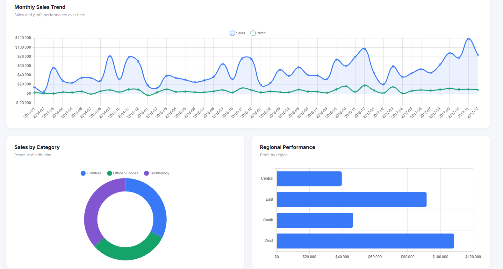

# Sales Data Analysis Dashboard

An interactive sales analysis dashboard built using Python, Flask, HTML, CSS, JavaScript, and Chart.js. This project explores the Superstore dataset to analyze sales performance, profitability, customer behavior, and regional trends.

## Project Overview

The goal of this project is to transform raw sales data into meaningful insights through data analysis and interactive visualizations.

The dashboard allows users to explore business performance using filters and interactive charts.

## Technologies Used

- **Python** – Data processing and analysis
- **Pandas & NumPy** – Data manipulation
- **Matplotlib & Seaborn** – Data visualization and exploratory analysis
- **Flask** – Backend and API
- **HTML5 & CSS3** – Frontend structure and styling
- **JavaScript** – Dashboard interactions
- **Chart.js** – Interactive charts
- **Jupyter Notebook** – Exploratory Data Analysis


## Dashboard Preview


## Dataset

The project uses the Superstore dataset from Kaggle.

- Dataset: [Superstore Dataset](https://www.kaggle.com/datasets/vivek468/superstore-dataset-final)
- Records: 9,994
- Features: 21 columns

## Dashboard Features

- Key Performance Indicators (KPIs)
- Total Sales, Total Profit, Orders, and Customers
- Monthly Sales and Profit Trends
- Sales by Category
- Regional Performance Analysis
- Top 10 Customers
- Interactive Filters:
  - Year
  - Region
  - Category
- Reset Filters

## Project Structure

```text
Sales-Data-Analysis/
├── data/
├── images/
├── notebooks/
├── static/
│   ├── css/
│   └── js/
├── templates/
├── sales_analysis.ipynb
├── app.py
├── server.py
├── requirements.txt
└── README.md
```

## Installation and Setup

### 1. Clone the repository

```bash
git clone https://github.com/nacerimohamed/Sales-Data-Analysis.git
cd Sales-Data-Analysis
```

### 2. Create a virtual environment

```bash
python -m venv venv
```

### 3. Activate the environment

Windows PowerShell:

```powershell
.\venv\Scripts\Activate.ps1
```

### 4. Install dependencies

```bash
pip install -r requirements.txt
```

### 5. Run the dashboard

```bash
python server.py
```

Open your browser and visit:

```text
http://127.0.0.1:5000
```

## Analysis Highlights

- Technology is the highest-performing category in terms of sales and profit.
- The West region generates the highest total sales and profit.
- The Consumer segment contributes the largest share of sales.
- Tables and Bookcases are among the sub-categories with negative profit.


## Author

**Mohamed Naceri**

[GitHub](https://github.com/nacerimohamed)

[Portfolio](https://mednaecri.netlify.app/)

---

This project was developed for learning and portfolio purposes.
